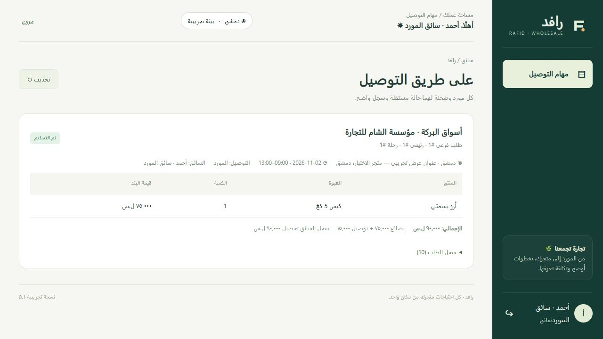

# تحقق تسليم النسخة الأولية

تاريخ التحقق: 2026-10-31. النطاق: [نسخة اليومين](MVP_48H.md).

## تحقق آلي منفذ

- `npm run check`: اجتاز فحص JavaScript للخادم والواجهة وأداة النسخ الاحتياطي.
- `npm test`: نجحت 19 نتيجة اختبار (18 سيناريو داخل اختبار دورة جامع)، دون فشل.
- اختبارات HTTP حقيقية على قاعدة مؤقتة مستقلة، لا على قاعدة العرض أو بيانات عملاء.
- تغطية عزل الأدوار والعروض الخاصة، دورة موردين، تكرار التأكيد، حجز آخر وحدة، تغير السعر، الرفض والتحرير، فحص إسناد السائق، الرمز والتحصيل، الشكاوى والتقييم والتقارير، رحلات المنصة والتعثر، التوصيات وسعة المواعيد وحد استخدام العرض.
- إعادة تشغيل الخادم مع بقاء الطلبات والجلسة، والخروج الذي يبطل الجلسة.
- نسخة احتياطية أثناء عمل الخادم، وفحص سلامة SQLite ومقارنة عدد الطلبات ومجموع قيمها من النسخة المستعادة.
- إقلاع بيئة غير تجريبية بمدير واحد دون موردين أو حسابات عرض، ورفض كلمة مدير قصيرة ورفض استخدام قاعدة demo في الوضع الحقيقي.

## تحقق واجهة منفذ في المتصفح

دخول محل → مقارنة موردين لنفس العبوة → إضافة إلى السلة → عنوان ورسوم وموعد → توصية مع إجمالي ومرجع توفير → تأكيد الطلب → دخول المورد وقبول وتجهيز → اختيار الطلب وإسناد سائق → دخول السائق وقبول واستلام وتحريك ووصول → ظهور رمز للمحل → إدخال الرمز كسائق → حالة «تم التسليم» وتسجيل التحصيل.

كشف الاختبار عيوبًا في تحديث عداد السلة، واختيار عرض عام، وتعريف نموذج التسليم بسبب تداخل اسم حقل مع خاصية form.id. أصلحت وأعيد تنفيذ التسليم في المتصفح بنجاح. اختبارات API تغطي المسارين والموردين والتزامن؛ السيناريو اليدوي في المتصفح أكمل طلبًا من مورد واحد.

## حدود الأدلة

لا تدعي هذه النتائج نجاح تجربة موردين حقيقيين أو اختبار حمل إنتاجي أو نشرًا عامًا. ملفات Docker وCI مرفقة؛ لم يُبن Docker محليًا لعدم توفره. يلزم إعداد استضافة HTTPS وبيانات وسياسات تشغيل فعلية قبل الاستخدام التجاري. النسخة لا تشمل جميع الميزات المستقبلية في وثيقة التصور.
